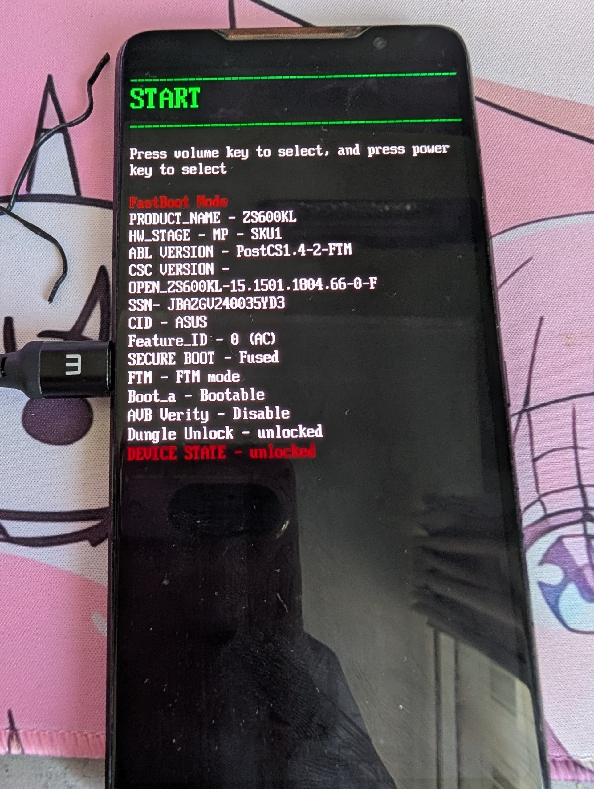

## Supported

| Device | Codename | Supported ABL | Unsupported ABL | ARB |
| --- | --- | --- | --- | --- |
| ROG Phone | `ZS600KL` / `Z01QD` | `16.0420.2009.39` | - | No |
| ROG Phone 2 | `ZS660KL` / `I001D` | `18.0210.2201.215` | - | No |
| ROG Phone 5 / 5 Pro / 5 Ultimate | `ZS673KS` / `I005D` | `33.0210.0210.242` | - | - |
| ROG Phone 5s / 5s Pro | `ZS676KS` / `I005D` | `33.0210.0210.242` | - | - |
| ROG Phone 6 / 6 Pro | `AI2201` | `33.0610.2810.159` | `34.0210.0210.276` | Yes |
| ROG Phone 6D / 6D Ultimate | `AI2203` | `34.0804.1204.107` | - | - |
| ROG Phone 7D | `AI2301` | `33.0403.0403.46` | - | - |
| ZenFone 8 | `ZS590KS` / `I006D` | `33.0210.0210.296` | `33.0210.0210.332` | No |
| ZenFone 8 Flip | `ZS672KS` / `I004D` | `33.0210.0210.309` | `33.0210.0210.331` | No |
| ZenFone 9 | `AI2202` | `33.0804.2060.165` | - | Yes |
| Snapdragon Insiders | `ZS675KW` / `I007D` | `18.1055.2307.269` | - | No |

## Not supported

| Device | Codename |
| --- | --- |
| ROG Phone 3 | `ZS661KS` / `I003D` |
| ROG Phone 7 / 7 Ultimate | `AI2205` |
| ROG Phone 8 / 8 Pro / 8 Ultimate / 9 FE | `AI2401` / `WW_AI2401` / `CN_AI2401` |
| ROG Phone 9 / 9 Pro / 9 Ultimate | `AI2501` |
| ZenFone 5z | `ZS620KL` / `Z01RD` / `Z01R` |
| ZenFone 6 | `ZS630KL` / `I01WD` |
| ZenFone 7 | `ZS670KS` / `I002D` |
| ZenFone 7 Pro | `ZS671KS` / `I002DD` |
| ZenFone 10 | `AI2302` |
| ZenFone 11 Ultra | `AI2401_H` / `ZWW_AI2401` |
| ZenFone 12 Ultra | `AI2501H` |

## Other methods

- [ROG Phone 3](https://xdaforums.com/t/rog-phone-3-bootloader-unlock-guide.4671658/)
- [ROG Phone 9 / 9 Pro](https://xdaforums.com/t/tool-edl-rog-phone-9-9-pro-ai2501-offline-bootloader-unlock.4798270/)
- [ZenFone 6](https://github.com/transaero21/asus-zenfone6-unlock)

## rog-unlock.jpg

